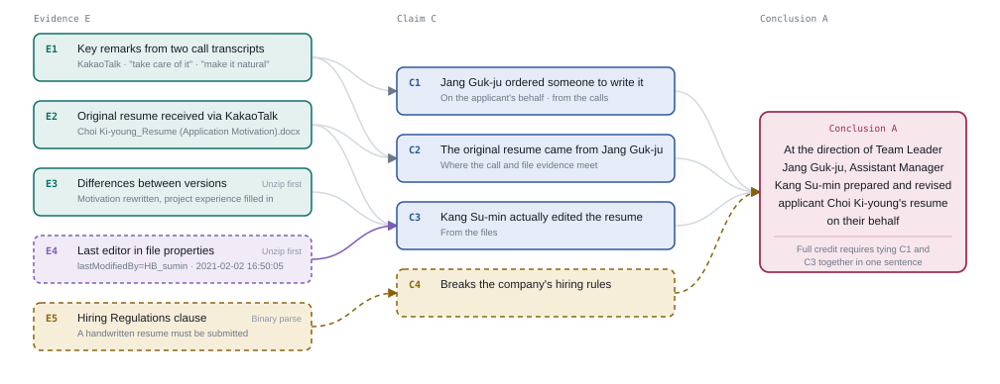

# Hyena Forensic Agent Lite


Hyena Forensic Agent Lite is a data-generation environment for studying how open-source LLM agents conduct digital forensic investigations. Built on [mini-swe-agent](https://github.com/SWE-agent/mini-swe-agent), it gives an agent a single bash tool to investigate the HYENA 2021 evidence data and submit a report in a fixed format. Each run is saved as a trajectory (`traj.json`) containing the conversation, tool commands and observations, and final report. The repository also includes an evaluation pipeline for analyzing those investigation trajectories and reports.

## Project structure

```
.
├── LICENSE                   repository license
├── requirements.txt          agent and evaluator Python dependencies
├── exp/
│   ├── case.yaml             agent, sandbox, and model request configuration
│   ├── tasks/                8 investigation tasks (q1.md through q8.md)
│   ├── Dockerfile            sandbox image definition
│   ├── osint/                offline investigation tools and lookup data
│   ├── ocr_build/            evidence index and verification script
│   └── run.sh                runs one selected model across the tasks
└── eval/
    ├── answer_key/           answer specifications and answer graph figures
    ├── src/                  trajectory parsing and evaluation code
    └── .env.example          optional LLM judge configuration
```

## Data generation

### Requirements

- Linux or WSL2
- Docker
- Python 3.10 or later
- vLLM and a GPU suitable for the selected model
- HYENA 2021 evidence data when running an investigation

### 1. Install the agent dependencies

Run from the repository root:

```bash
python3 -m venv .venv
source .venv/bin/activate
pip install -r requirements.txt
```

### 2. Build the sandbox

Build the image from the repository root:

```bash
docker build -t forensics-case exp
```

Rebuild the image if you change the Dockerfile or files copied into it from `exp/osint`.

### 3. Start one vLLM model

Run one selected model on the machine that will execute the experiment. The model ID passed to `run.sh` must match the ID served by vLLM. `exp/case.yaml` points to the OpenAI-compatible API at `http://127.0.0.1:8000/v1`.

```bash
vllm serve <model-id> --port 8000 --max-model-len 131072 <model-specific options>
```

For the models used in the experiments, the vLLM options are:

| Model | Additional vLLM options |
|---|---|
| `openai/gpt-oss-20b`, `openai/gpt-oss-120b` | `--tool-call-parser openai --enable-auto-tool-choice` |
| `Qwen/Qwen3.8-27B` | `--reasoning-parser qwen3 --tool-call-parser qwen3_xml --enable-auto-tool-choice` |
| `Qwen/Qwen3-30B-A3B-Thinking-2507` | `--reasoning-parser deepseek_r1 --tool-call-parser hermes --enable-auto-tool-choice` |
| `google/gemma-4-26B-A4B-it`, `google/gemma-4-31B-it` | `--reasoning-parser gemma4 --tool-call-parser gemma4 --enable-auto-tool-choice --default-chat-template-kwargs '{"enable_thinking":true}'` |

These are server startup options for parsing tool/reasoning output and, for Gemma, setting the default chat-template thinking mode. They do not select or load multiple models. Confirm that the selected model is available from the server before running the experiment. Request settings such as `reasoning_effort` are configured in `exp/case.yaml` and only affect generation when supported by that model and vLLM version.

### 4. Run an experiment

Run from the repository root while the virtual environment, Docker, and vLLM server are available:

```bash
bash exp/run.sh <model-id> <run-name> [repetitions=5] [jobs=4]
```

Example:

```bash
bash exp/run.sh openai/gpt-oss-20b high
```

The run name labels the output directory; it does not change inference settings. Edit `exp/case.yaml` before starting a run when changing request settings. The script runs 8 tasks for each repetition, so the defaults produce 40 task runs for the selected model. `jobs` is the maximum number of task runs sent concurrently to that one vLLM server; choose a value the server can handle with its available memory and context capacity. Completed runs are skipped when rerunning the same command, so the script can continue an interrupted batch. Use a new run name when changing an inference condition to keep outputs separate.

Runs are saved under:

```
runs/<model-id-with-slashes-replaced>/<run-name>/q<task>/r<repetition>.traj.json
runs/<model-id-with-slashes-replaced>/<run-name>/q<task>/r<repetition>.log
```

Each trajectory records the conversation (including `reasoning_content` when returned by the model), exit status, submitted report, and configuration used for that run.

### Agent settings

The default settings in `exp/case.yaml` include:

| Setting | Value |
|---|---|
| Step limit | 200 |
| Wall-time limit | 5,400 seconds per task |
| Command timeout | 120 seconds |
| Temperature | 1.0 |
| Tool choice | `required` (the agent must call the bash tool) |

Command output longer than 10,000 characters is shortened to its first and last 5,000 characters. The agent must write its report to `/tmp/report.md` in the required `## Conclusion` and `## Findings` format, then submit it with the `submit` command.

### Optional: prepare and verify the evidence data

This step is only needed when you are ready to run an investigation; you can install dependencies and build the sandbox without configuring the evidence directory. The HYENA 2021 evidence data is not included in this repository. Before running an experiment, replace `/path/to/hyena_ctf` in `exp/case.yaml` under `environment.run_args` with the absolute path to your evidence directory on the machine running Docker. Docker mounts it read-only at `/case`, and the container has no network access.

The OCR and speech-transcription tools look up precomputed results by file-content SHA-1. Verifying the data is optional, but helps confirm those lookups will work:

```bash
bash exp/ocr_build/verify_evidence.sh /absolute/path/to/hyena_ctf
```

The expected check is 2,110 files checked and 0 mismatches. The agent can still run if files mismatch, but OCR or transcription results may not be found for those files.

## Evaluation

The evaluator in [`eval/`](eval/) scores agent run data to examine where an investigation followed or departed from the evidence-supported reasoning path. It evaluates support relations between evidence, hypotheses, and the final answer, rather than treating the investigation as a single sequence. The answer-key YAML files are the source of truth; the SVG answer graphs visualize the same specifications.

### Evaluation concepts

#### Answer graph

The answer graph represents support relationships, not the chronological order of an investigation. Evidence nodes (E) support sub-hypotheses (h) and auxiliary claims (x), which together support the final answer (G). An edge shows that the connected evidence or claim is relevant to supporting the next claim; each node's judging conditions specify what the evaluator checks before counting it as established.

For each question, `eval/answer_key/Q*/q*.yaml` is the machine-readable source of truth: it defines the evidence fingerprints, hypothesis conditions, supporting evidence, and answer criteria. The corresponding `answer_graph_Q*.svg` is the visual representation of that specification. In the diagrams, hypothesis and auxiliary-claim nodes use labels `C1`, `C2`, ... (hypotheses first, then auxiliary claims); the final answer appears as `Conclusion A`, corresponding to YAML key `G`.

Question 1 example:



The YAML keys are:

| Key | Content |
|---|---|
| `evidence` | Evidence file conditions: path and content fingerprints |
| `hypotheses` / `aux` | Sub-hypotheses and auxiliary claims, their judging conditions, and their supporting evidence |
| `answer` | Final-answer criteria (FAS) |
| `aliases` | Alternate spellings of people used while matching names |

A **claim** is one sentence from the model's final report and its citations. **Claim linking** attaches each claim to the hypothesis it states. An **outside-graph claim** fills no judging condition of any hypothesis. Claims that satisfy only some conditions can still attach to a hypothesis and are not automatically outside-graph errors.

### Scoring flow

| Step | Summary | Code |
|---|---|---|
| Evidence detection | A file is counted as read only when its content fingerprint appears in the output of the call that opened it. Citations are also checked against evidence reads. For outside-evidence citations, the evaluator searches successful calls for the file name or pieces of its original text; PST/OST files use stricter text-match thresholds. | `src/scoring/evidence.py`, `src/scoring/values.py` |
| Claim linking | An LLM judges whether each claim states a hypothesis judging condition as fact; the code verifies and aggregates the result. | `src/scoring/claims.py` |
| Relations | Each claim and citation is classified as `C_on`, `V_on`, `C_off`, `V_off`, or `U`. | `src/scoring/values.py` |
| Call class | A call is on if it reads evidence content, off if it reads an outside-evidence file cited by an outside-graph claim, and grey otherwise. | `src/scoring/values.py` |
| `S_rqi` | A hypothesis is proved when it was stated, its supporting evidence was obtained, and its citations are not all `V_on`. | `src/scoring/values.py` |
| Final judgment | An LLM judges whether the final conclusion matches the answer (FAS) and whether error-path claims leaked into the conclusion. | `src/scoring/final.py` |

| Relation | Meaning |
|---|---|
| `C_on` | Claim is attached to a hypothesis and cites supporting evidence that was opened and fingerprint-confirmed. |
| `V_on` | Claim is attached to a hypothesis, but its citation points to another hypothesis's evidence, outside evidence, or evidence without a recorded read. |
| `C_off` | Outside-graph claim cites a file that was actually opened. |
| `V_off` | Outside-graph claim has no record of opening its cited file; a file outside the evidence set counts as opened when its name appears in a successful call. |
| `U` | Factual claim has no citation. |

### Metrics

| Metric | Question | Direction |
|---|---|:---:|
| FAS | Does the final conclusion match the answer (LLM final judgment)? | 0/1 |
| FPS | Were all sub-hypotheses proved (all `S_rqi` are 1)? | 0/1 |
| EBC | How much supporting evidence was obtained? | ↑ |
| UCR | Share of factual claims with no opened citation (`C_on` · `C_off`). | ↓ |
| RVR · Assess. | Share of violating citations (`V_on` · `V_off`) and share that could be judged. | ↓ · ↑ |
| Focus · Drift | Share of correct-path and error-path calls. | ↑ · ↓ |
| Onset · Return | When the first deviation occurs and rate of returning after deviating. | ↑ · ↑ |
| Leak | Did error-path claim content enter the final conclusion (LLM final judgment)? | ↓ |
| FirstHit · ToolErr · Time | Efficiency measures. | — |

When a metric's denominator is 0, its value is `N/A`, not 0.

### Report format expected by the evaluator

The evaluator extracts claims and citations when the final report follows this English format. For the integrated mini-swe-agent trajectories, it also accepts the agent's `## Findings` heading and `- Finding:` items as equivalent. Other formats are treated as `free`: the conclusion is empty and claims are counted per paragraph.

```
## Conclusion
<conclusion>

## Claims
- Claim: <one verified fact>
  Evidence: `<path of the evidence file>`
```

The integrated evaluator also accepts the data-generation agent's `## Findings` section with `- Finding:` items and the same `Evidence:` citation lines. The parser also supports its documented trajectory and JSONL inputs; see `eval/src/parser/` for the implementation details.

### Evaluation data

Neither the HYENA evidence set nor agent run logs are included in the repository. Obtain the run data and evidence set from the paper's data release, then arrange them as follows:

| What | Where | Notes |
|---|---|---|
| Codex run logs (`rollout-*.jsonl`) | `eval/data/Q<N>/<attempt>/*.jsonl` | `<N>` is question number 1–8; `<attempt>` is any folder name, such as `01`. |
| mini-swe-agent trajectories | `runs/<model-id-with-slashes-replaced>/<run-name>/q<N>/r<R>.traj.json` | Pass the model/run-name directory (the directory directly containing `q<N>` folders) to `--traj`. |
| HYENA CTF 2021 evidence set | `eval/HYENA_CTF/` or a path set in `HYENA_ROOT` | Use the same evidence material and original sub-folder layout seen by the agent. The evaluator only reads this directory. |

The original agent logs may cite evidence paths under `C:\WM_HYENA_TEST\`. The evaluator maps a cited path to the local evidence copy by the portion after `WM_HYENA_TEST\\`, so preserve that relative folder layout under `HYENA_ROOT`.

### Install and configure the evaluator

The evaluator dependencies are included in the root `requirements.txt`. Activate the environment created in the data-generation setup. If you are setting up only the evaluator, create and install the root environment from the repository root:

```bash
python3 -m venv .venv
source .venv/bin/activate
pip install -r requirements.txt
```

Copy the example environment file and set the API credentials only when using `--judge`:

```bash
cp eval/.env.example eval/.env
```

Edit `eval/.env`:

```dotenv
API_KEY=your-school-api-key
BASE_URL=https://your-school-api-base/v1/gateway
```

`BASE_URL` is the API gateway root; the evaluator appends `/chat/completions/`. If omitted, it uses the MindLogic gateway URL used in the original implementation. `.env` is ignored by Git. The judge currently uses the model ID `gemini-3.8-flash`; `BASE_URL` changes the service endpoint, not the model ID. `HYENA_ROOT` can instead be set in the shell to point to the evidence set; its default is `eval/HYENA_CTF/`. `READPST` selects the `readpst` executable (default `readpst`).

### Run the evaluator

Run from the repository root:

```bash
python eval/src/main.py
python eval/src/main.py 1 --judge
python eval/src/main.py --no-parse
python eval/src/main.py --traj runs/openai_gpt-oss-20b/high
```

The first command parses all of `eval/data/`, scores the runs, and writes score tables. `--judge` performs LLM claim linking and final judgment (FAS and Leak) before scoring; judged inputs are not judged again. `--no-parse` scores existing parsed results without parsing again. `--traj` expects a directory containing `q<N>/r<R>.traj.json` paths; pass the model/run-name directory created by `exp/run.sh`. For Codex JSONL parsing and other options, see:

```bash
python eval/src/main.py --help
```

### Evaluation files and outputs

```
eval/answer_key/Q*/          answer specs (q*.yaml) and answer graph figures
eval/data/Q<N>/<attempt>/    input Codex run JSONL files
eval/output/Q<N>/<attempt>/  parsed calls, reports, and per-run scoring details
eval/src/main.py             parsing and scoring entry point
eval/src/parser/             JSONL and trajectory parsing
eval/src/scoring/            evidence, claims, values, metrics, and pipeline
```

| Output | Content |
|---|---|
| `rollout-*.csv` and `*.report.json` | One row per tool call; report conclusion and claims/citations. |
| `evidence_reads.csv` | Evidence file and first call that read it, with confirming quote. |
| `cite_links.csv` | Claim citation mapped to evidence read status (`confirmed`, `evidence_not_read`, or `outside_evidence_set`). |
| `claims_map.json` | Claim-linking result: hypothesis, outside graph, or not factual. |
| `final_map.json` | Final judgment: FAS match, quote, missing content, and Leak details. |
| `off_calls.json` | For each outside-evidence citation: source, text characters, matched pieces, named calls, and read calls. |
| `relations.csv` and `call_class.csv` | Relations (`C_on`, `V_on`, `C_off`, `V_off`, `U`) with reasons and on/off/grey call classes. |
| `scores.csv` | Per-run metrics; `Trace` uses `O` on, `X` off, `.` grey, `!` failed, and `+` new evidence. |
| `output/scores_all.csv` | Combined scores with `Question` and `Attempt` columns. |

## License

This repository includes an MIT license in [`LICENSE`](LICENSE). Third-party software, datasets, evidence, and other externally sourced materials may have separate terms; check their respective notices before reuse.
